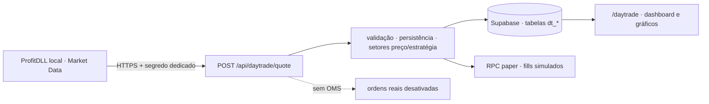

# DASH — arquitetura do escritório Day Trade

**DASH** significa **Day-trading Analysis & Strategy Hub**. É o módulo de pesquisa e simulação de day trade no produto ATLAS. Este documento descreve o código atual e suas dependências externas; não declara operação pronta nem rentabilidade.

## Estado implementado

- A rota `/daytrade` usa a autenticação do proprietário do ATLAS. As leituras privadas exigem AAL2; gravações do proprietário verificam origem e sessão. A ingestão do coletor usa um segredo próprio, separado de `CRON_SECRET`, e identifica o proprietário no servidor.
- `gateways/profitdll/gateway.py` é um processo Windows x64 separado, somente leitura. Inicializa Market Data, agrega negócios em candles M1 e envia snapshots HTTPS para `POST /api/daytrade/quote`. Não carrega funções de ordens ProfitDLL nem compartilha a ponte MT5 do DAWN.
- A API confere símbolo ativo e verificado, expiração, origem, atraso, sequência, tick, OHLCV, turnover e alinhamento/ordem dos candles antes de persistir. Dados e eventos DASH usam tabelas `dt_*` próprias, com `owner_id`; o caminho do navegador não recebe a service role.
- As tabelas DASH lidas pela interface têm `SELECT` explicitamente concedido a `authenticated` e RLS com política do proprietário/AAL2; isso não depende da exposição automática da Data API. `dt_market_history_sessions` é marcador interno: RLS ativo, sem leitura autenticada e acesso apenas pelo service role em rotas server-side.
- As RPCs externas de persistência paper/cotação são os únicos pontos de entrada do service role. Wrappers usam `SECURITY DEFINER` com `search_path` vazio e nomes qualificados; execução direta dos helpers internos é revogada para `PUBLIC`, `anon`, `authenticated` e `service_role`, impedindo saltar os gates de validação.
- `feedWorker` e `priceWorker` verificam proveniência, frescor, integridade e continuidade. `strategyWorker` produz observações explicáveis de rompimento da faixa inicial com VWAP e EMA; não produz ordens. O dashboard lê candles e observações persistidos.
- `backtestWorker` avalia três candidatos congelados por walk-forward, usando pregões completos de calendários oficiais, custos, slippage, perda máxima por operação/dia e o limite de operações diárias. Ele simula reentradas até os limites configurados; resultados são exploratórios e nenhum resultado aprova automaticamente uma estratégia.
- O motor paper usa RPC Postgres transacional e idempotente em `dt_paper_state`/`dt_paper_fills`: sinal após candle fechado, fill simulado na barra seguinte, custos, slippage, stop/gap, limite diário e zeragem. A RPC confere sessão persistida e kill switch dentro da transação; a trava de configuração sincroniza a parada do proprietário com cada nova entrada. Fills e posições paper são separados dos livros/posições do ATLAS e da corretora.
- Trabalhadores de notícias/calendário, risco, chefia, supervisão, execução paper, estados de ordens e snapshots de posição têm contratos explícitos em `src/core/daytrade/agents.ts`. A ausência de cobertura de notícias ou de estado de risco reconciliado bloqueia o ciclo genérico. O pipeline não envia ordens.
- O código do scheduler central chama `/api/daytrade/cycle` na nuvem a cada minuto, autenticado com `CRON_SECRET` e timeout limitado; a falha desse ciclo é registrada sem parar o scheduler do ATLAS. Essa chamada passa a valer em produção após publicar esta versão. A ingestão ProfitDLL continua independente e somente leitura.
- O layout e favicon de `/daytrade` são específicos do DASH; o shell e favicon geral ATLAS permanecem separados.

## Fluxos

## Configuração e bloqueios atuais

O modo aceito pelo schema é `SIMULATED`. `config/daytrade.json` mantém os defaults públicos; margem, horários de entrada/zeragem, limites e custos específicos da conta são salvos pelo proprietário em `dt_settings.execution_config` (inclui ticks de slippage escolhidos como premissa do modelo), com fonte declarada, confirmação AAL2 e registro append-only em `dt_journal`. Um rascunho não libera o paper; a confirmação habilita apenas os cálculos paper/backtest e nunca o modo real. A estratégia continua não aprovada. Não usar estimativas para remover as travas.

O contrato configurado é WINZ26, com vencimento em 16/12/2026; deve ser atualizado antes do vencimento. O gateway requer pacote/licença/ativação oficial ProfitDLL para Windows x64 e credenciais digitadas no terminal. O arquivo local de variáveis não deve ser versionado. A Vercel hospeda o BFF e a interface, não a DLL nativa nem o coletor contínuo.

As migrations DASH estao versionadas em `supabase/migrations/`. O historico remoto foi conferido em 03/11/2026 e esta sincronizado ate `20261103025606_daytrade_paper_session_boundary_gap`; a consulta remota confirmou grants e RLS atuais nas tabelas DASH. As sete migrations anteriores foram aplicadas em ordem: persistencia autoritativa do historico, configuracao de risco por proprietario, P&L de zeragem entre pregoes, kill switch transacional, substituicao integral de sessoes historicas, validacao de risco dentro do banco e tratamento de lacuna na fronteira do pregao. A zeragem na abertura do primeiro candle em `flatBy` continua na migration `20261102213431_daytrade_session_flat_open_fill`. As migrations locais posteriores estao pendentes: `20261103025607` a `20261103025611` cobrem capital/equity paper, validacao estrutural de candles, restricoes paper-only e paridade de custos/slippage; `20261103040811` fecha os RPCs internos contra chamadas diretas; `20261103041225` exige confirmacao persistida e confere os parametros de risco/custo usados em cada candle. Todas passaram pelos testes PGlite; nenhuma foi aplicada ao remoto. O banco estava sem dados de feed e paper na consulta anterior. Confira novamente o historico remoto antes da publicacao em lote.

- Cada fill paper e espelhado na tabela append-only `dt_ledger` via trigger PostgreSQL transacional, com chave unica vinculada ao fill para idempotencia e P&L bruto/liquido. Isso registra paper; nao reconcilia posicoes da corretora nem lanca dinheiro real.

A ingestao da cotacao e dos candles ocorre em uma unica RPC transacional. O banco aceita a cotacao somente se timestamp/sequencia forem monotonicamente mais recentes; candles parciais tambem carregam `source_exchange_at`, impedindo que uma requisicao atrasada sobrescreva um candle atualizado. A importacao completa do historico ProfitDLL substitui os minutos live da sessao; reimportacoes sao serializadas, atualizam o marcador e substituem o conjunto inteiro de candles do dia para remover minutos obsoletos. O mesmo caminho passa EMA 9 e VWAP ao motor paper; o banco enfileira a saida na proxima abertura quando o fechamento invalida um desses filtros, como no backtest.

Candles fechados recebidos depois do limite `data.staleAfterMs` continuam persistidos para consulta e backtest, mas nao geram observacoes de sinal nem fills paper retroativos. Se a coleta retomar apos uma lacuna, o proximo candle fresco deixa o motor paper detectar o intervalo e aplicar a regra conservadora de lacuna antes de permitir novas entradas. Se um feed interrompido ainda deixar uma posicao aberta na troca do dia, a zeragem no primeiro candle disponivel registra o resultado liquido no limite de perda do novo dia, impedindo que uma perda carregada libere novas entradas por um reset silencioso.

## Limites operacionais

- O preflight autenticado de `/api/daytrade/history` lista os pregões já persistidos nos últimos 30 dias; o gateway só pula datas confirmadas pelo Supabase. Estado local do coletor não é fonte de verdade, e dias sem negócios não são marcados como importados.

- Roteamento real, reconciliação de conta Genial, alarmes externos e disponibilidade permanente ainda não estão homologados. O gate de notícias usa os calendários oficiais do BCB, notícias BCB e RSS habilitados no ATLAS, com frescor por fonte; essa cobertura é limitada e falha fechada quando alguma fonte fica ausente ou vencida. As observações de pesquisa continuam sem gerar ordens. Não habilitar ordens reais.
- O coletor solicita trades históricos ProfitDLL dia a dia, até os 30 dias de retenção documentados pela Nelogica, e importa candles M1 apenas após o callback indicar conclusão. Sessões com erro ou sem trades não são marcadas como importadas; gaps e pregões incompletos continuam excluídos de estratégias/backtests que exigem continuidade.
- VWAP requer total de preço × quantidade dos negócios; candles legados sem turnover não são usados para esta análise.
- Stops no paper são regras de simulação. Não equivalem a stop aceito pela corretora.
- Custos são cobrados nos dois lados e slippage adverso é modelado; fills OHLC de um minuto não reproduzem fila, liquidez, latência ou execução real.
- Uma estratégia só pode ser considerada após validação independente, fora da amostra, com custos, análise de risco e revisão humana. Backtest não garante resultado futuro.
- Credenciais de corretora, chaves de ativação, tokens e segredo de ingestão nunca devem entrar em código, Git, navegador ou logs. A API valida proprietário/AAL2 para leitura; service role permanece apenas no servidor.

## Arquivos principais

| Área | Caminho |
|---|---|
| Configuração/readiness | `config/daytrade.json`, `dt_settings.execution_config`, `src/core/daytrade/config.ts` |
| Estratégia e walk-forward | `src/core/daytrade/analysis.ts`, `docs/daytrade/METODOLOGIA.md` |
| Contratos e setores | `src/core/daytrade/agents.ts`, `src/core/daytrade/desks.ts`, `docs/daytrade/AGENTES.md` |
| Sessão B3 | `src/core/daytrade/session.ts`, `src/core/b3-calendar.ts` |
| API e persistência | `src/app/api/daytrade/[resource]/route.ts`, `src/lib/daytrade/store.ts` |
| Gateway ProfitDLL | `gateways/profitdll/` |
| Schema e RPCs | `supabase/migrations/*_daytrade_*.sql` |
| Interface DASH | `src/components/daytrade/`, `src/app/daytrade.css` |
