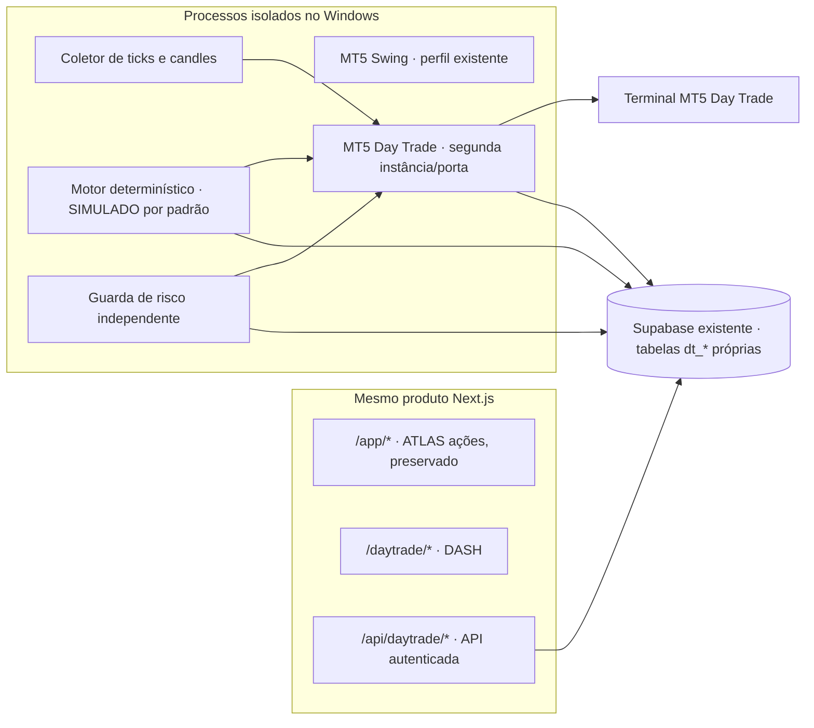

# DASH — arquitetura do escritório Day Trade

**DASH** significa **Day-trading Analysis & Strategy Hub** (*Centro de Análise e Estratégia de Day Trade*). É o nome do novo escritório de day trade dentro do produto ATLAS.

**Estado desta etapa:** plano e leitura do repositório, sem implementação funcional do DASH. A execução real continua bloqueada. Este documento descreve o repositório observado em 31/10/2026 e registra a linha de base local.

## Objetivo e fronteiras

O DASH será um módulo de day trade separado do escritório atual de ações à vista. O escopo planejado começa por WIN (mini-índice); WDO (mini-dólar) fica para uma fase posterior. A estratégia não é presumida lucrativa: pesquisa, custos, dados fora da amostra e validação podem reprovar todas as estratégias, mantendo o sistema em modo SIMULADO.

Compartilhamento planejado com ATLAS:

- aplicação Next.js e implantação web;
- sessão Supabase Auth e identidade do proprietário, com MFA/AAL2 nas operações sensíveis;
- mesmo projeto Supabase, usando tabelas próprias `dt_*` e políticas próprias;
- utilitários puros e comprovadamente compatíveis, como valores decimais, calendário, leitura de notícias e a ponte MT5, depois de validados para futuros.

O DASH terá estados, dados, estratégias, pesquisa, processos, risco, kill switch, journal e ledger próprios. O compartilhamento do projeto Supabase não significa compartilhar tabelas ou saldos. O ledger de ações, o ledger de Paper Trading e o ledger do DASH precisam permanecer identificáveis e separados.



O desenho é uma proposta, não uma infraestrutura já instalada. A conectividade entre hospedagem web e gateway local, segredos, reinício de processos, armazenamento de dados e implantação em Windows/VPS ainda precisam ser definidos e validados. A Vercel não executa o terminal MT5.

## O que existe e pode ser reutilizado, com limites

| Área | Caminhos existentes | Reutilização possível | Limite observado |
| --- | --- | --- | --- |
| Next.js/React | `src/app/`, `src/components/`, `src/proxy.ts`, `next.config.ts` | Adicionar grupo de páginas `/daytrade/*` e componentes DASH | O shell atual e as rotas `/app/*` não devem mudar nesta fase; a rota API atual centraliza recursos de ações em `src/app/api/atlas/[resource]/route.ts`. |
| Autenticação | `src/lib/auth.ts`, `src/lib/env.ts`, `src/lib/supabase.ts`, `src/proxy.ts`, `src/app/app/layout.tsx` | Reutilizar `requireOwner()` e a sessão do Supabase | `requireOwner()` exige AAL2 por padrão, mas existe bypass exclusivamente local em `127.0.0.1`; rotas e layouts DASH precisam preservar essas condições e negar acesso fora da allowlist. |
| Supabase e banco | `supabase/migrations/`, `tests/database.test.ts`, `src/lib/supabase.ts` | Mesmo projeto e harness PGlite; migrations aditivas próprias para `dt_*` | Há 28 migrations existentes, tabelas atuais em `public`, RLS e funções privilegiadas. Não alterar tabelas/migrations de ações, `paper_*`, `system_state`, `ledger_*` ou `executor_*` para acomodar o DASH, salvo integração de kill switch estritamente delimitada e documentada. |
| Dinheiro | `src/core/money.ts`, domínio `public.atlas_decimal` na migration de fundação | Reutilizar validação de strings decimais e cálculos exatos | O domínio SQL existente é `numeric(28,10)`; revisar escala, valor do ponto, contratos e arredondamento específicos dos futuros antes de reutilizar. Python e SQL devem continuar usando `Decimal`/`numeric`, nunca float para dinheiro/P&L. |
| IR e datas | `src/core/tax.ts`, `src/core/b3-calendar.ts` | Reutilizar helpers somente depois de confirmar compatibilidade | `tax.ts` já separa resultados de day trade de ações e operações comuns, mas sua entrada é `TaxFill` de ticker/quantidade/preço; não modela ajuste diário, futuros, margem ou especificidades fiscais dos minicontratos. `b3-calendar.ts` é um guard conservador para ações à vista, tem janela 10:05–16:50 e lista 2027 provisória; não é um calendário operacional confirmado para WIN/WDO. |
| Estratégia/risco/OMS | `src/core/risk.ts`, `src/core/oms.ts`, `src/core/executor.ts`, `src/lib/executor.ts`, `src/providers/execution-gateway.ts` | Referência para contratos, auditoria, idempotência e estados de falha | O domínio de risco valida `assetClass === "EQUITY"`, lotes de ações e ordens LIMIT/STOP_LIMIT; OMS e executor atuais são do fluxo de ações. Não conectar o motor DASH diretamente a eles sem separar domínio, persistência, identidade de conta e invariantes de futuros. |
| IA de notícias | `src/core/news-ai.ts`, `src/lib/news-ai.ts` | Reusar leitura de manchetes e configuração de provedor após limitar permissões | A implementação atual gera etiquetas de contexto de ações e grava no banco. Não é um agente trader e não deve ganhar acesso a credenciais, gateway ou escrita de ordens. DASH só poderá usar IA para reduzir risco/bloquear entradas e redigir relatório, com fontes e schema validados. |
| Ponte MT5 | `gateways/mt5/gateway.py`, `gateways/mt5/probe.py`, `gateways/mt5/README.md`, `gateways/mt5/test_gateway.py`, `gateways/mt5/test_genial.py` | Estender o código compartilhado e manter compatibilidade do perfil Swing | O gateway atual valida exclusivamente ações à vista B3 e permite apenas LIMIT/DAY, sem stop na posição. Não está pronto para contratos futuros ou execução de DASH. |
| Interface visual | `src/components/shell.tsx`, estilos em `src/app/globals.css`, páginas em `src/app/app/` | Reutilizar tokens/componentes neutros, quando adequado | A interface não comprova estado de mercado, preenchimento ou lucratividade. DASH deve mostrar `PENDING`/vazio quando não houver dado persistido, ter responsividade e respeitar movimento reduzido. |
| Testes e CI | `vitest.config.ts`, `tests/`, `gateways/mt5/test_*.py`, `.github/workflows/ci.yml`, `package.json` | Usar Vitest/PGlite para banco e MT5 falso em testes Python; CI já prepara Python 3.13 | Linha de base: 629 testes Vitest passaram, 15 foram ignorados; 69 testes Python passaram. Novos testes devem ser aditivos; não editar testes de ações para fazer DASH passar. |

## Estrutura nova planejada

```text
daytrade/                         domínio e processos Python exclusivos do DASH
  atlas_dt/                       config, relógio, contratos, custos, risco, ledger,
                                  estratégias, pesquisa e simulação
  recorder.py                     coleta somente leitura de ticks e M1
  engine.py                       execução determinística, SIM por padrão
  risk_guard.py                   processo independente com veto
  context_ai.py                   contexto e relatório sem autoridade de ordem
  tests/                           fixtures sintéticas e MT5 falso
src/app/daytrade/                  páginas /daytrade/*
src/app/api/daytrade/[resource]/   BFF autenticado e validado
src/components/daytrade/           shell, painéis e estados do DASH
src/lib/daytrade/                  consultas server-side de dados dt_*
supabase/migrations/*_daytrade_*   schema aditivo, RLS e RPCs próprias
docs/daytrade/                     arquitetura, pesquisa, runbook e readiness
```

Nomes, organização e runtime serão confirmados contra o código durante a etapa de esqueleto. A primeira entrega de mercado planejada é WIN. WDO, meta-labeling, hospedagem VPS e qualquer operação real não são requisitos para concluir as primeiras etapas.

## Proteção do ATLAS de ações

1. Não alterar o comportamento do perfil `GENIAL_SWING`, nem compartilhar porta, journal SQLite, halt file, variáveis do processo ou sessão do terminal com a instância Day Trade.
2. Não alterar rotas `/app/*`, tabelas atuais, funções RPC, comportamento de ações/estratégias, ledger de ações ou Paper Trading. Mudança transversal só pode ser considerada se indispensável, explicitamente descrita e compatível com os testes existentes.
3. Criar e consultar dados DASH por caminhos e tabelas `dt_*` próprios, com `owner_id`, RLS em cada tabela exposta, menor privilégio e funções privilegiadas cuidadosamente restritas. A service role não substitui a verificação do proprietário/AAL2 na API.
4. A ponte Day Trade deve rodar como segunda instância/processo, com porta, perfil, conta, terminal, journal e halt file próprios. O motor não importa o SDK MT5 para enviar ordens; usa um cliente autenticado para a ponte local/privada.
5. Um kill switch global já existe para o ATLAS. A integração DASH deve ser unidirecional e conservadora: uma trava global pode bloquear novas entradas no DASH; a trava DASH não deve mudar o estado operacional do escritório de ações. Cancelamentos/zeragem precisam ser confirmados no terminal, não presumidos.
6. Testes de envio usam somente um adaptador MT5 falso em memória. Nenhuma etapa técnica liga execução ou altera `.env.local` de produção.

## Segurança operacional e critérios de produto

- Modo padrão `SIMULATED`, usando dados de mercado reais somente se a origem, horário, frescor e continuidade forem conhecidos. Preenchimento simulado deve ser conservador e incluir custos/slippage.
- Sem dado fresco, sessão confirmada, calendário conhecido, terminal/ponte conectados, heartbeat válido ou ausência de halt file: bloquear novas entradas. Erros/desconhecidos não são convertidos em neutro.
- Regras que decidem sinais são determinísticas, versionadas e testadas. LLM não envia ordens, não acessa credenciais/gateway e só pode reduzir tamanho ou bloquear, com registro da fonte; falha não inventa análise.
- Todo trade real futuro exige stop efetivamente aceito/confirmado na corretora. Proteção apenas na memória do processo não satisfaz o requisito.
- Segredos permanecem fora do código, Git, navegador e logs. A senha da corretora é digitada pelo proprietário no terminal; chaves privadas nunca usam `NEXT_PUBLIC_`.
- Não declarar estratégia lucrativa por desenho ou backtest in-sample. Validar custos, walk-forward, out-of-sample, leakage, look-ahead e overfitting. Se nenhuma passar critérios previamente definidos, a conclusão correta é permanecer SIMULADO.
- Não usar `pandas-ta`, `mlfinlab`, modelos de trading pré-treinados baixados da internet ou LSTM para prever preço.
- Limites de risco propostos no prompt são requisitos a analisar, não parâmetros já validados para o capital/conta do proprietário. Custos e especificações de WIN/WDO precisam vir de documentação atual da B3/Genial, probe da conta e conferência de nota; os números do prompt são aproximações não homologadas.

## Diferenças observadas entre o plano e o código atual

| Tema | Plano do DASH | Estado observado em 31/10/2026 | Efeito para as próximas etapas |
| --- | --- | --- | --- |
| Nome/escritório | DASH, dentro do produto Atlas | Não há páginas, componentes ou diretório `daytrade/` | Implementar rotas próprias quando a etapa de UI chegar; nesta etapa só registra-se o nome. |
| Perfil MT5 Day Trade | Segunda instância capaz de futuros e execução controlada | `GENIAL_DAY_TRADE` já aparece em `gateways/mt5/gateway.py` e no README, mas `submit` é recusado com `DAY_TRADE_ENVIRONMENT_SUBMIT_UNSUPPORTED`; a allowlist de instrumentos aceita só `B3_CASH_EQUITY` | Existe um perfil nominal de leitura, não um gateway de futuros. Qualquer extensão requer desenho específico e não pode alterar Swing. |
| Ordens protegidas | Stop obrigatório registrado na corretora | O contrato e as validações atuais só aceitam ordem pendente LIMIT/DAY; sem SL/TP no fluxo | Definir suporte a ordem/posição protegida, confirmação pós-fill, fallback de zeragem e testes MT5 falso antes de considerar operação real. |
| Ledger e schema | Tabelas novas `dt_*`, kill switch e ledger DASH próprios | A fundação atual tem tabelas públicas de ações, executor, paper, ledger e estados globais; migrations são aplicadas por ordem e testadas em PGlite | Criar migrations aditivas isoladas. Testar política e RPC com os papéis Auth simulados já usados em `tests/database.test.ts`. |
| Calendário/dados | Tick, M1, calendário de futuros, sessão e contrato vigente | Dados atuais são principalmente ações, candles diários e fontes destinadas à análise; o calendário local é para ações; não existe coletor MT5 intraday DASH | Provar disponibilidade/horário/símbolo WIN$ e contrato vigente; não misturar série contínua de pesquisa com símbolo de ordem. |
| Custos e fatos de mercado | Defaults WIN/WDO no prompt | Nenhuma fonte/probe Day Trade foi inspecionada ou homologada; integração Genial documenta modalidade e limitações, mas não confirma os valores aproximados da tabela do prompt | Tratar ticks, valor financeiro, margem, vencimentos, taxas, slippage e horários como `UNVERIFIED` até confirmação oficial. Não codificar valores de suposição como fatos. |
| IR | Extender `src/core/tax.ts` sem regressão de ações | `tax.ts` já separa operações comuns e day trade de ações, com carry separado; não representa ajuste diário dos futuros | Modelagem fiscal de futuros é trabalho separado, com fonte oficial/contador e testes de regressão da lógica atual. |
| Agentes/IA | Traders, mesa e relatório pós-pregão | Agentes atuais são do domínio de ações; `news-ai` retorna etiquetas de contexto e não escolhe ordens | Não reaproveitar personalidade/autoridade de agente existente como decisor; motor DASH deve ser determinístico e compartilhar apenas dados/relatórios limitados. |
| Autorização | Mesmo proprietário/MFA/AAL2 | `requireOwner()` confere proprietário UUID e AAL2 por padrão; bypass local existe apenas no loopback de desenvolvimento | Confirmar comportamento de `/daytrade` e `/api/daytrade/*` nos testes de acesso; rotas de escrita devem usar BFF e validação estrita. |
| Deploy | Mesmo frontend Vercel e processos MT5 no Windows/VPS | App roda Next/Vercel; gateway MT5 roda em Windows e não é hospedado pela Vercel. Execução atual está bloqueada; processos fora do PC não foram homologados | Definir transporte privado, supervisão, backup e comportamento em queda antes de qualquer etapa operacional. |
| CI e dependências | Adicionar pytest/ruff ao CI se Python disponível | CI já configura Python 3.13 e executa unittest para a ponte; `package.json` não possui scripts DASH/Pytest/Ruff | Acrescentar dependências/scripts só quando houver código Python DASH; pin de versões e lockfile/requirements são necessários. |

## Linha de base local

Executado em 31/10/2026, antes das alterações desta Etapa 0, no diretório raiz do projeto:

| Comando | Resultado |
| --- | --- |
| `npm run lint` | Passou (executado por `npm run check`). |
| `npm run typecheck` | Passou; `next typegen` gerou tipos e `tsc --noEmit` terminou sem erro. |
| `npm test` | 56 arquivos passaram, 11 ignorados; 629 testes passaram, 15 ignorados. |
| `npm run build` | Passou em Next.js 16.3.5. O Turbopack avisou que o acesso dinâmico em `src/lib/live-view.ts:41` pode incluir a árvore do projeto no tracing do servidor. |
| `npm run test:mt5` | Passou: 69 testes unittest, sem MetaTrader5 real. Uma mensagem de falha de `symbol_info_tick` foi gerada pela fixture de teste que exercita fallback; o processo terminou `OK`. |

Nenhuma falha preexistente foi observada nessa linha de base. Isso verifica apenas o ambiente local e doubles; não comprova conexão, custos, execução ou conta real.

## Decisões pendentes antes de implementação financeira

- Confirmar com fontes oficiais atuais os símbolos e especificações do WIN, horários e leilões, calendário de eventos, vencimentos/rolagem, tick/valor do ponto, margem, taxas e corretagem efetivas da conta Day Trade.
- Confirmar autorização e limitações da modalidade Genial Day Trade para automação externa Python/MT5, stop associado, zeragem compulsória, consultas e comportamento de reconexão; ausência de conta demo significa que o modo SIMULADO não é homologação de execução.
- Definir de onde vêm e onde são armazenados ticks/M1, retenção, licenças de uso e gaps; separar gravação de pesquisa e feed ao vivo.
- Revisar as métricas de aprovação do prompt (incluindo DSR/PBO, mínimo de trades e janelas) antes de automatizá-las; especificar casos de dados insuficientes e múltiplos testes.
- Revisar os limites diários/mensais com o proprietário e profissional qualificado antes de configurá-los; não tratar percentuais do prompt como recomendação financeira.
- Definir processo de incidentes, backup, disponibilidade, alarmes fora do painel e operação com terminal/PC desligados.

Nenhuma decisão pendente permite ativar modo REAL nesta etapa. O modo real do futuro DASH permanece desligado por desenho, com ativação dependente de etapas, evidências e autorização explícita posteriores.

## Verificação depois das alterações documentais

Após criar este documento e `AGENTS.md`, lint, typecheck, os 629 testes Vitest (15 ignorados) e os 69 testes Python passaram novamente. `npm run build` não concluiu: Next.js recebeu `EPERM` ao remover um arquivo de `.next/static` dentro da pasta sincronizada pelo OneDrive. O mesmo build havia passado antes das alterações documentais. Nenhum código de produção foi alterado e nenhum contorno de permissão foi aplicado; a conclusão do build fica pendente de executar o comando em um estado de filesystem sem bloqueio.
