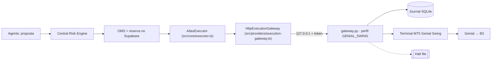

# Integração Genial Investimentos via MetaTrader 5

Atualizado em **22/10/2026**. Complementa a [decisão do gateway](../EXECUTION_GATEWAY_DECISION.md) e a [pesquisa MT5](MT5_GATEWAY_RESEARCH.md). Nenhuma conta foi conectada, nenhum terminal foi autenticado por este trabalho e nenhuma ordem foi enviada. `LIVE_TRADING_ENABLED` permanece `false`.

## 1. Evidência da corretora

| Pergunta | Resposta Genial (atendimento, protocolo **3975509**, 06/10/2026) | Classificação no ATLAS |
| --- | --- | --- |
| Automação externa em Python com o pacote oficial `MetaTrader5` | Permitida; a Genial **não dá suporte** à configuração da estratégia | Evidência comercial. A página pública da Genial cita apenas robôs MQL5, não Python ([robôs no Swing](https://suporte.genialinvestimentos.com.br/hc/pt-br/articles/8180979249940-Que-tipo-de-rob%C3%B4-eu-posso-usar-para-operar-no-MetaTrader-Swing-Trade)). Guardar o e-mail/protocolo fora do repositório |
| Ambientes | MetaTrader **Day Trade** e **Swing Trade** são distintos | Confirmado também na [página de modalidades](https://suporte.genialinvestimentos.com.br/hc/pt-br/articles/360055813771-Posso-operar-Swing-Trade-no-MetaTrader-5) |
| Enviar, cancelar e consultar ordens, execuções e posições | Sim, **com limitações** relativas às informações da conta | Limitações não detalhadas: caixa liquidado, custódia fora do MT5 e taxas finais continuam sem fonte reconciliável |
| Custo do MetaTrader 5 | Zero | Não inclui emolumentos B3, impostos nem hospedagem |
| Conta demo | Não disponível; sugerido backtest do MetaTrader | O Strategy Tester não exercita a ponte Python, o journal nem a recuperação. Não substitui homologação |

Fato documental adicional: **a versão Swing Trade é limitada ao sistema Netting** (mesma página de robôs acima). Uma conta Netting mantém uma única posição por símbolo; a atribuição a agentes continua no ledger ATLAS por fill.

### O que continua não confirmado

- Nome exato do servidor Swing exibido no terminal. Só o proprietário consegue ler após o login.
- Se `account_info().margin_mode` retorna `RETAIL_NETTING` ou `EXCHANGE` nessa conta. A [documentação MQL5](https://www.mql5.com/en/docs/constants/environment_state/accountinformation) define `EXCHANGE` para mercados de bolsa, sem declarar explicitamente que é netting. O perfil aceita ambos e recusa `RETAIL_HEDGING`.
- Lista de ações à vista negociáveis no servidor Swing, mercado fracionário (`PETR4F`), lote, tick, `filling_mode` e se `LIMIT` + `DAY` são aceitos por símbolo.
- Se o limite operacional do MT5 Swing é segregado do restante da conta ([estrutura de limite](https://suporte.genialinvestimentos.com.br/hc/pt-br/articles/4403328046868-Estrutura-de-limite-operacional)).
- Custos totais por ordem nesse canal (corretagem efetiva, emolumentos, liquidação, ISS).
- Comportamento do terminal após reconexão, reinício do Windows e troca de sessão.

Nenhum desses itens vira `true` por configuração. O probe somente leitura (seção 4) produz a evidência para os quatro primeiros.

## 2. Arquitetura do GenialMT5Executor

O "GenialMT5Executor" **não é um segundo Executor**. É o Executor existente com a ponte MT5 rodando no perfil `GENIAL_SWING`. Assim o OMS, o Risk Engine, o journal e a recuperação já testados são reaproveitados sem cópia.



| Componente | Arquivo | Papel na Genial |
| --- | --- | --- |
| Executor | `src/core/executor.ts`, `src/lib/executor.ts` | Recebe somente comandos aprovados pelo Risk/OMS, revalida, despacha uma vez, recupera por consulta. Um `health.reason` (ex.: `GATEWAY_HALTED`) restringe a fila a cancelamentos |
| Transporte | `src/providers/execution-gateway.ts` | Fixa conta e `providerId` (`GENIAL_MT5_SWING`) |
| Ponte | `gateways/mt5/gateway.py` | Perfil Genial: exige conta REAL em BRL, recusa hedging, exige halt file; perfil `GENIAL_DAY_TRADE` lê, mas nunca envia ordens novas |
| Probe | `gateways/mt5/probe.py` | Validação **somente leitura** da conexão e dos símbolos |
| Persistência | migration `20260916045026_atlas_executor_gateway.sql` | Comandos, claims, fills deduplicados, ledger por agente, auditoria |

### Por que o Day Trade não envia ordens

O ambiente Day Trade pode zerar posições compulsoriamente antes do fechamento. Os agentes do ATLAS mantêm posição de um dia para o outro, e uma zeragem externa quebraria a atribuição no ledger. O perfil `GENIAL_DAY_TRADE` existe para leitura e cancelamento; `submit` retorna `DAY_TRADE_ENVIRONMENT_SUBMIT_UNSUPPORTED`.

### Trava (kill switch) local do gateway

Além do kill switch persistente do ATLAS, a ponte tem uma trava em arquivo (`ATLAS_MT5_HALT_FILE`), obrigatória nos perfis Genial:

- **Liga sozinha** quando ocorre qualquer resultado que indique divergência entre o journal e a corretora: despacho ambíguo/timeout, termos divergentes após envio ou recuperação, fills inconsistentes, ordem ambígua, correção de negócio, conta trocada no terminal ou conta hedging.
- **Enquanto existir**, recusa `submit` e `modify` (`GATEWAY_HALTED`). Cancelamento continua permitido porque só reduz exposição. Replays de respostas já confirmadas continuam funcionando porque não enviam nada.
- **Guarda o primeiro motivo** e sobrevive a reinícios. Arquivo ilegível também conta como travado.
- **Só o proprietário destrava**, apagando o arquivo depois de reconciliar ordens e posições no terminal com o painel do ATLAS.

### Idempotência e reconciliação (já existentes, aplicam-se à Genial)

1. O comando é persistido e reservado no Supabase antes do despacho; claim exclusivo por comando.
2. O journal SQLite grava a intenção **antes** de `order_send`. Mesma chave com termos diferentes resulta em `IDEMPOTENCY_CONFLICT`.
3. Timeout ou erro após o envio deixa o comando `UNKNOWN`. A recuperação procura a ordem por `magic` + comentário e confere todos os termos econômicos. **Não há reenvio automático.**
4. Fills são deduplicados pelo ticket do negócio e aplicados ao ledger do agente uma única vez.
5. A reconciliação completa da conta continua bloqueada (`completeAccountReconciliation=false`). O MT5 não comprova caixa liquidado, e `balance`/margem livre não viram saldo do Treasury.

## 3. Configuração (máquina Windows com o terminal)

Variáveis novas da ponte, além das descritas no [README da ponte](../../gateways/mt5/README.md):

| Variável | Valor para a Genial |
| --- | --- |
| `ATLAS_MT5_BROKER_PROFILE` | `GENIAL_SWING` |
| `ATLAS_MT5_HALT_FILE` | Caminho absoluto fora do OneDrive, ex.: `C:\atlas-data\mt5-halt.json`. O arquivo **não** deve existir no início |
| `ATLAS_MT5_ACCOUNT_MODE` | `REAL` (o perfil recusa `OFFICIAL_SANDBOX`, porque a Genial não tem demo) |
| `ATLAS_MT5_EXPECTED_SERVER` | Servidor Swing exatamente como aparece no terminal |
| `ATLAS_MT5_ENABLE_EXECUTION` | `false` |
| `ATLAS_MT5_PROVIDER_ID` | Omitir: o perfil define `GENIAL_MT5_SWING` |

No backend: `ATLAS_GATEWAY_PROVIDER_ID=GENIAL_MT5_SWING`, `LIVE_TRADING_ENABLED=false`.

No terminal: **Ferramentas → Opções → Expert Advisors**, deixar desmarcado *"Disable automated trading via external Python API"*. O botão **Algo Trading** pode ficar desligado durante a fase somente leitura.

## 4. Validação somente leitura

Com o terminal Genial Swing aberto e autenticado por você:

```powershell
$env:ATLAS_MT5_TERMINAL_PATH = 'C:\Program Files\Genial MetaTrader 5\terminal64.exe'  # ajuste ao seu caminho
.\.venv-mt5\Scripts\python.exe gateways/mt5/probe.py --profile GENIAL_SWING --symbols PETR4,VALE3,ITUB4 --expected-server "<servidor exibido no terminal>"
```

O probe:

- usa um proxy que só expõe funções de consulta (`order_send`, `order_check`, `login` e qualquer outra chamada não listada geram erro antes de chegar ao terminal);
- não lê senha, token, saldo, patrimônio ou margem; o login sai mascarado (`****678`);
- verifica conexão, conta REAL em BRL, modo de margem não-hedging, servidor esperado, permissão de API Python e, por símbolo, se é ação à vista B3 com LIMIT/DAY;
- sugere a entrada de `instruments.json` de cada símbolo aprovado. **A sugestão precisa ser conferida por você** antes de ir para o arquivo privado;
- termina com código 0 quando os requisitos obrigatórios passam e 2 quando algo falha.

Depois, com o arquivo de instrumentos preenchido, iniciar a ponte com execução desligada e o Executor do ATLAS. A primeira conexão só registra a identidade da conta como `PENDING`.

## 5. Infraestrutura

- **Desenvolvimento:** o seu Windows, com terminal + ponte + `npm run local` + `npm run executor`. O PC precisa ficar ligado.
- **Depois:** VPS Windows de uso geral (estimativa já documentada em [COST.md](../../COST.md) e na decisão: cerca de US$ 44/mês para 4 GB, sujeito a medição). O Virtual Hosting MetaQuotes não roda Python. A Genial Cloud custa R$ 41,40/mês sem isenção, e a isenção exige operar minicontratos, o que não deve ser feito só para obter o desconto.
- O painel Next.js pode ir para a Vercel e o banco continua no Supabase, mas a ponte e o terminal **não** rodam na Vercel. Não foi encontrada VPS Windows gratuita e adequada.

## 6. O que depende de você

Nada abaixo deve ser colado no chat ou no repositório.

1. Guardar o e-mail do protocolo 3975509 fora do Git e, se possível, pedir à Genial por escrito: lista de símbolos de ações à vista no servidor Swing, se há fracionário, tipos/validades de ordem aceitos, se o limite do MT5 Swing é segregado e a tabela de custos efetiva desse canal.
2. Contratar/ativar o **MetaTrader Swing Trade** na Genial e instalar o terminal oficial no Windows.
3. Fazer login no terminal você mesmo. O ATLAS nunca recebe a senha.
4. Instalar Python x64 e criar o ambiente virtual (`gateways/mt5/README.md`).
5. Rodar o probe (seção 4) e revisar o JSON. Pode me mostrar o relatório: ele não contém saldo nem login completo.
6. Gerar `ATLAS_MT5_TOKEN` em um gerenciador de senhas e configurá-lo nos dois lados.
7. Decidir orçamento de VPS quando a fase local estiver validada.
8. Somente depois de todos os gates de [LIVE_READINESS.md](../LIVE_READINESS.md): autorizar explicitamente uma primeira ordem real de validação, com ativo, quantidade, preço limite e janela definidos por você. Isso não é feito por nenhum teste nem por esta entrega.
